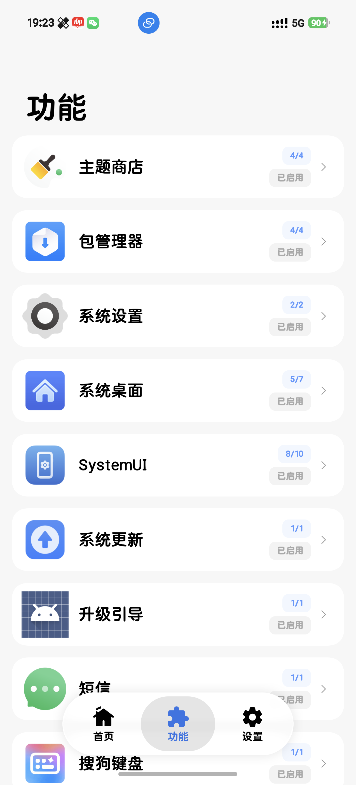
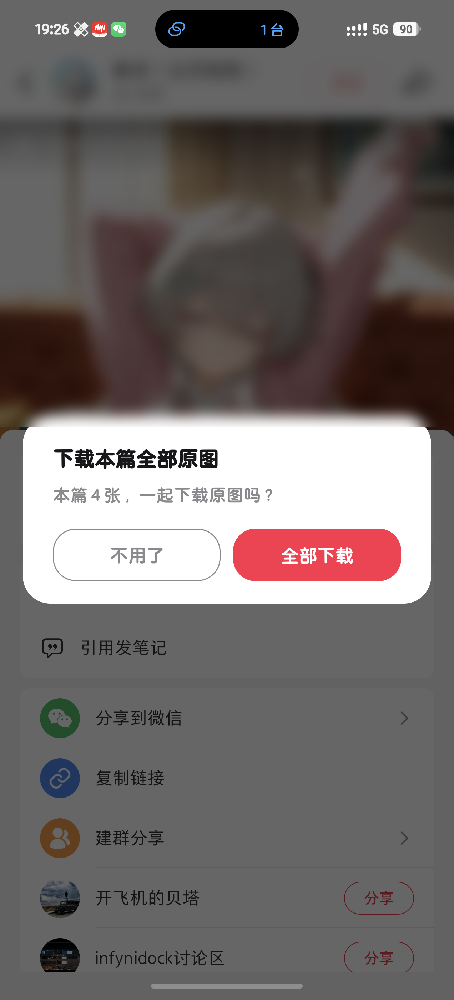
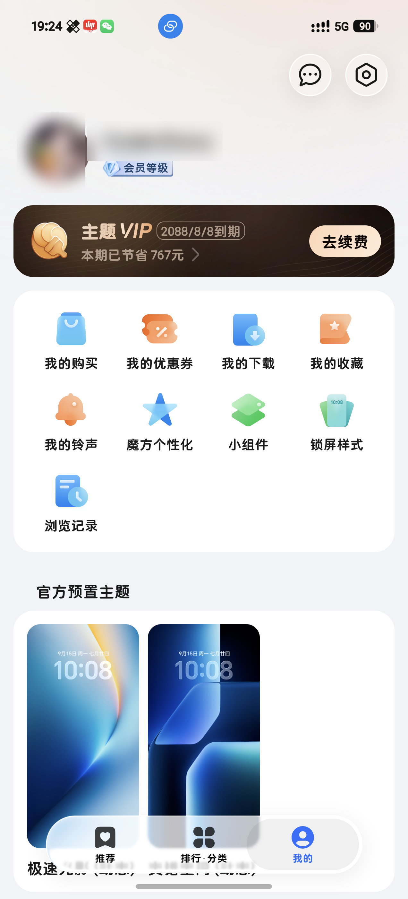

# HonorHook

**给荣耀手机用的去广告 / 解锁 / 隐私小工具**

一个 LSPosed 模块 —— 重铸荣耀昔日之光

| 功能面板 | 小红书：保存被模块接管 | 主题商店：会员态 |
| :---: | :---: | :---: |
|  |  |  |

真机截图，MagicOS 11 / AAK-AN00。账号和头像做了模糊处理，小红书那张的背景是别人的内容，也一起模糊了。

---

## 这是什么

HonorHook 需要 LSPosed 才能跑，就是那个能在系统里加载模块的框架。它只干一件事：把荣耀出厂时塞进去的广告、推广、数据上报和会员限制摘掉，其他地方不碰。

功能默认都是开的，装上就用。想关哪一项，在面板里关掉，再把那个应用重新打开一次。

改动都发生在应用运行的内存里：不写系统分区，不碰应用数据，不装额外的东西。手机重启就恢复原样，卸载模块等于彻底还原。模块自己也不收集、不上传你的数据，对外只做一件事：查一下有没有新版本。

## 改了哪些地方

### 系统应用

| 应用 | 改了什么 |
|---|---|
| **主题商店** | 会员状态直接显示为已开通，资源免费用，试用不倒计时，底部的推广 tab 和广告消失，下载走会员通道，动态壁纸能正常应用 |
| **包管理器** | 安装页不再请求广告和 AB 实验，广告与推广卡不展示，三方跳转不拦，跳过联网安全检测，不再提示开安全模式 |
| **系统桌面** | 隐藏 YOYO 卡片的标题文字（图标留着），文件夹点开不再多一次确认，清后台时保留当前应用 |
| **系统更新** | 不在后台自己检查更新，不走 WiFi 自动下载，不在夜间安装，不弹升级提醒（手动检查更新照旧可用） |
| **系统管家** | 病毒检测、查杀、病毒弹窗全禁，装完不会再弹「发现病毒应用」 |
| **系统设置** | 应用详情页的「停用」按钮一直可点（荣耀会给管控应用置灰），首页 HONOR ID 账户的小红点隐藏 |
| **短信** | 推广卡片清掉 |
| **SystemUI** | 隐藏副卡图标、5G 标识、双排信号和双排 5G 制式标，替换 WiFi 与状态栏图标，隐藏充电、热点、USB 调试通知，手电筒忽略低电量 |
| **升级引导** | 「发现新版本」的全屏引导页闪一下就退 |
| **视频壁纸** | 高画质转码，去掉时长限制，循环播放 |

### 荣耀的预装应用

| 范围 | 改了什么 |
|---|---|
| **广告**（系统 App） | 信息流、横幅、开屏、插屏、激励广告都不再出现 |
| **数据上报**（系统 App） | 上报的数据在本地就被收住，事件不落库、不出网 |
| **日历** | 服务卡和资讯推荐位整条收掉 |
| **搜狗键盘（荣耀版）** | 候选区的功能不用再点同意 |

### 第三方应用

| 应用 | 改了什么 |
|---|---|
| **小红书** | 解除保存限制并接管下载：保存视频时不再有宿主自己的提示，只弹一次模块的下载卡，可以一次下完原图 |
| **京东** | 开屏广告跳过 |
| **MFA 身份验证器** | 开屏广告跳过 |
| **成人高考题库** | 会员档位、有效期、特权等级都显示成超级会员 |

## 支持哪些版本

下面这些版本都在真机上验过：

| 应用 | 版本 |
|---|---|
| 主题商店 | 20.1.63.305 |
| 包管理器 | 14.0.37.301、14.0.38.301、14.0.22.326 |
| 系统桌面 | 18.0.0.234 |
| 系统管家 | 17.0.0.414 |
| 小红书 | 9.50.0（9.49.1 也行） |
| 系统更新 | 18.0.3.230 |
| 搜狗键盘 | — |
| 系统设置 | — |
| 短信 | 19.0.9.306 |
| 京东 / MFA 身份验证器 | 16.1.0 / 1.0.5 |
| 广告与数据上报（系统 App） | — |

你的系统版本比上面新也没关系。LSPosed 日志里会多一行「宿主版本与基线不一致」，那只是提示，功能照常。

## 常见问题

**装完没反应？**

先看 LSPosed 里模块开关有没有打开、要管的应用有没有勾上；再确认那个应用被完全退出过，退到后台不算，模块只在你重新打开它的时候才起作用；最后看面板首页是不是写着「工作中」。

**日志在哪看？**

LSPosed 的模块日志，不是 logcat。每个应用启动时都有一行 `xxxHook[应用包名]: installed N/M`，两个数字一样就是全部生效。

**会不会变砖？**

不会。改动只在应用运行的内存里，不写系统分区，不改应用数据，不装额外的东西。

**某个功能不想要？**

面板的功能页里把对应的开关关掉，再把那个应用重新打开一次。不关就是全开。

**小红书保存后为什么弹的是模块的卡片？**

接管下载之后由模块来确认下哪些原图，所以不会弹宿主自己的分享引导，也不会连着弹两次。

## 免责声明

本项目仅供个人学习与研究 Android 框架与逆向工程之用，请于 24 小时内自行删除，勿用于任何商业用途；
因使用本项目产生的任何问题由使用者自行承担。

## 开源许可

本项目按 [GNU AGPL-3.0](LICENSE) 发布，完整的署名写在 [NOTICE](NOTICE) 里。

里面用了第三方项目 [XHS_Downloader_Android](https://github.com/NEORUAA/XHS_Downloader_Android)（同样是 AGPL-3.0）里解析小红书笔记的代码，以 git submodule 的方式引进来，一个字都没改，只有 7 个文件参与编译。对应源码在 [本仓库](https://github.com/coderstory/HonorHook) 和 [上游那个 commit](https://github.com/NEORUAA/XHS_Downloader_Android/tree/d5c0070328f82ff5f748de5c0b826161d5eaca8b)。

荣耀、Honor、MagicOS、YOYO 这些商标属于各自的权利人，本项目跟他们没有隶属或背书关系。

---

### 开发者

- 全部文档索引：[`docs/README.md`](docs/README.md)
- 挂载点台账和真机判据快照：[`docs/hook-inventory-audit.md`](docs/hook-inventory-audit.md)
- 怎么写 hook：[`docs/hook-craft.md`](docs/hook-craft.md) · 怎么逆向：[`docs/reverse-craft.md`](docs/reverse-craft.md)
- 构建和设备操作都走 `tools/dev.sh`（`tools/dev.sh help` 是唯一的命令索引）
