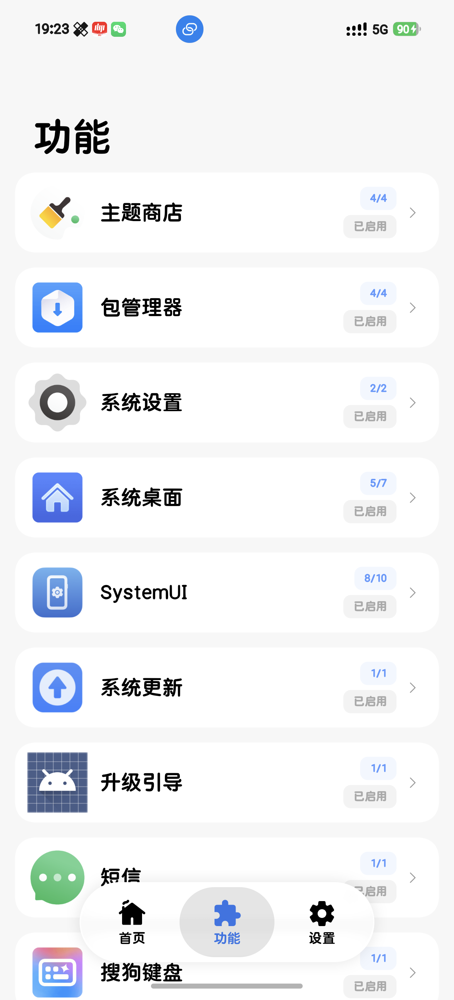
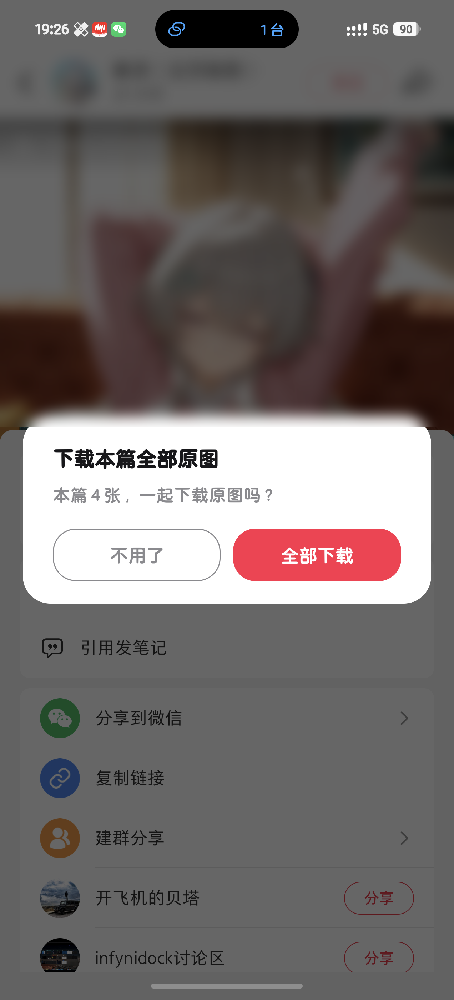
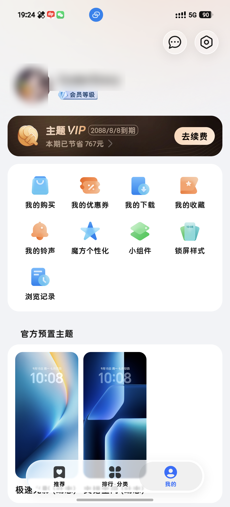

# HonorHook

**把荣耀手机里你不想要的东西，全部摘掉。**

去广告 · 解会员 · 护隐私 —— 一个 LSPosed 模块，重铸荣耀昔日之光

| 功能面板 | 小红书：保存被模块接管 | 主题商店：会员态 |
| :---: | :---: | :---: |
|  |  |  |

真机截图，MagicOS 11 / AAK-AN00

---

## 装上那一刻，手机就不一样了

不需要配置，不需要折腾。装上、在 LSPosed 里勾选、重启目标应用——所有功能默认全开，手机立刻安静下来。想关哪一项，面板里一键搞定。

### 🚫 广告，再见

- **系统级广告矩阵**：信息流、横幅、开屏、插屏、激励广告，荣耀系统应用里能见到的广告位全灭
- **应用市场 / 短信 / 日历**：弹窗、推送卡片、资讯推荐位，一条不留
- **搜狗键盘（荣耀版）**：开屏广告直达主界面，皮肤商店推广条目与横幅过滤
- **京东 / MFA 身份验证器**：开屏广告跳过，点开就是正脸

### 👑 会员限制，绕开

- **主题商店**：会员状态直接显示已开通，资源免费用、下载走会员通道，试用不倒计时，动态壁纸正常应用
- **成人高考题库**：会员档位、有效期、特权等级本地解锁（只改本机内存判定，不碰账户与计费）

### 💾 下载，自由

- **小红书**：保存限制解除，下载被模块接管——点保存只弹一次模块下载卡，视频直下原片不再落 720p 压缩件，原图可一次批量下完

### 🔕 骚扰，静音

- **系统更新**：不再后台自检、不走 WiFi 偷偷下载、不夜间安装、不弹升级提醒（手动检查照旧可用）
- **系统管家**：不再弹「发现病毒应用」
- **桌面 / 设置**：文件夹少一次确认，YOYO 标题、账户小红点隐身
- **状态栏**：副卡图标、5G 标识、双排信号、充电/热点/USB 调试通知，按需隐藏

### 🛠 面板，好看又好用

- 原神风格彩色图标、插画/花园背景主题、启动页手绘小机器人动画
- 首页动态萤火虫光效，明暗主题分别调优
- 每个目标应用的卡片直接显示已生效的功能数量，装没装上、生效没生效，一眼看到

## 为什么敢用

- **零痕迹**：所有改动只发生在应用运行的内存里——不写系统分区、不碰应用数据、不装额外东西。重启恢复原样，卸载即彻底还原
- **零收集**：模块自己不收集、不上传任何数据，对外只做一件事：查有没有新版本
- **零变砖**：改的是内存态，最坏情况也就是某个功能没生效，手机照常用
- **不想要就关**：每一项功能都有独立开关，面板里关掉、重开那个应用即可
- **版本适配透明**：主流荣耀应用多个版本真机验证过；宿主升级后也会在 LSPosed 日志明确提示基线是否一致

## 适用范围

荣耀 / MagicOS 手机，Android 8.0+，arm64。需要 [LSPosed](https://github.com/LSPosed/LSPosed) 框架。

逐应用的验证版本清单见 [`docs/README.md`](docs/README.md)。

## 免责声明

本项目仅供个人学习与研究 Android 框架与逆向工程之用，请勿用于任何商业用途；因使用本项目产生的任何问题由使用者自行承担。部分功能关闭的是系统自带的安全防护（如安装前联网检测、病毒扫描、系统更新提醒），请知悉后按需保留。逐功能边界见项目文档。

## 开源许可

本项目按 [GNU AGPL-3.0](LICENSE) 发布（署名见 [NOTICE](NOTICE)）。使用了 [XHS_Downloader_Android](https://github.com/NEORUAA/XHS_Downloader_Android)（AGPL-3.0，submodule 引入、逐字未改）。荣耀、Honor、MagicOS、YOYO 商标属于各自权利人，本项目与其无隶属或背书关系。

---

### 开发者

- 文档索引：[`docs/README.md`](docs/README.md) · 构建与设备操作统一入口 `tools/dev.sh`
